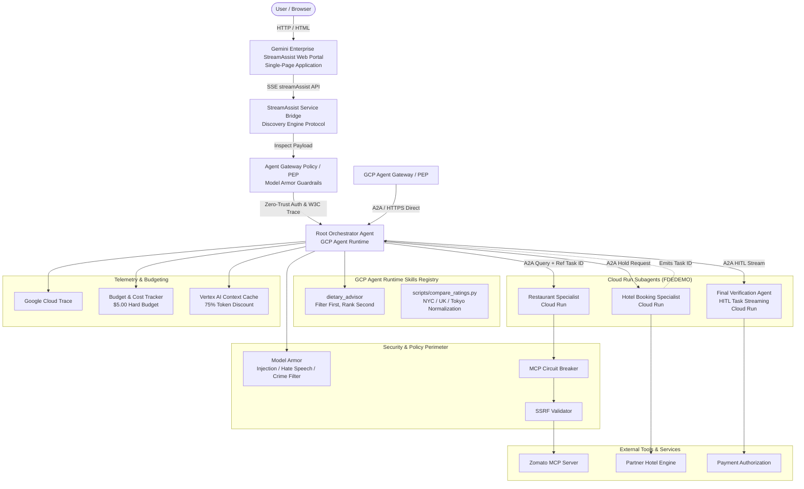
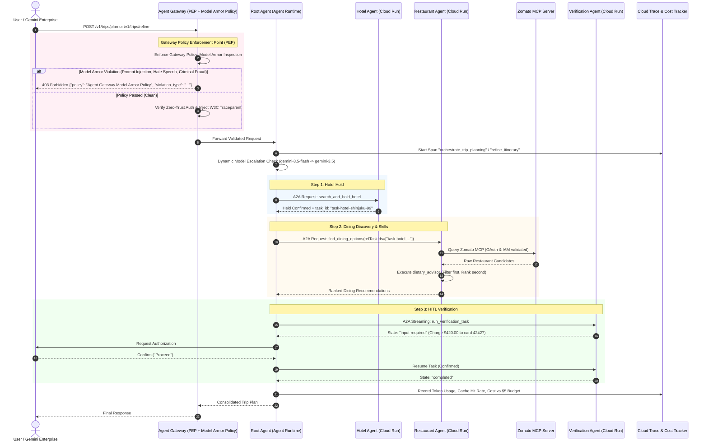
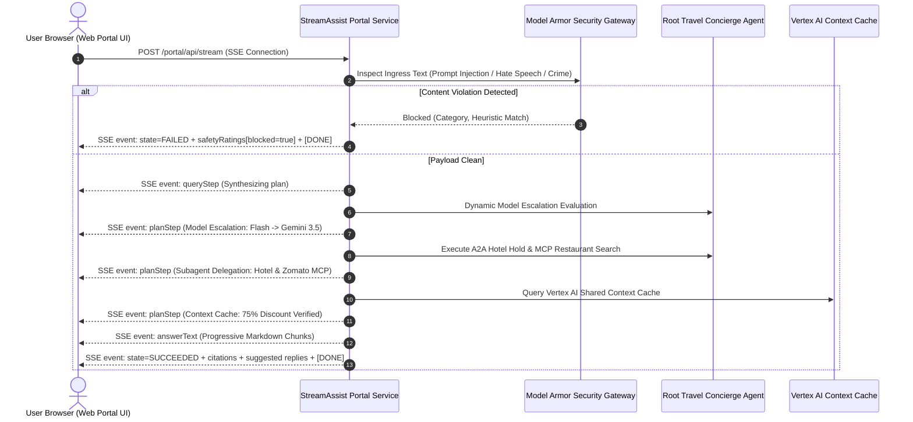

# Travel Concierge Multi-Agent System — Architecture Document

## 1. System Overview

The **Travel Concierge Multi-Agent System** is an enterprise-grade agentic application built on the **Google Agent Development Kit (ADK)** and Python, exposing **Agent-to-Agent (A2A)** standard interfaces. It coordinates specialized subagents to deliver multi-turn travel itinerary planning, dietary compliance validation, hotel reservations, restaurant discovery via MCP (Model Context Protocol), and human-in-the-loop (HITL) payment verification.

All components adhere to the **Agent eXperience Interface (AXI)** methodology, **Zero-Trust networking**, **least-privilege IAM**, dynamic **Model Armor** defense, and automated **GCP Agent Runtime Skills Registry** integration.

---

## 2. Component Topologies & Interaction Flows

### 2.1 Multi-Agent Orchestration & A2A Communication
1. **Root Orchestrator Agent (`travel_concierge_orchestrator`)**:
   - Deployed to **GCP Agent Runtime**.
   - Registered in **Gemini Enterprise Agent Registry** for natural discovery and invocation.
   - Manages global session state, explicit context caching, token compaction, and multi-turn itinerary refinements.
   - Features **dynamic model escalation** from `gemini-3.5-flash` to `gemini-3.5` (or `gemini-3.5-pro`) when constraint complexity or conflicting regional criteria require deeper reasoning.
2. **Hotel Booking Specialist (`hotel_booking_specialist`)**:
   - Deployed on **Cloud Run**.
   - Receives destination, dates, and guest criteria; reserves temporary room holds and emits a durable `reference_task_id` (e.g., `task-hotel-shinjuku-99`).
3. **Restaurant Specialist (`restaurant_booking_specialist`)**:
   - Deployed on **Cloud Run**.
   - Integrates with the **Zomato MCP Server** via secure streamable HTTP connection.
   - Enforces IAM group membership (`MCPUSERS`) and OAuth 2.0 scope (`restaurants.read`).
   - Uses the `dietary_advisor` skill to filter and rank restaurants.
4. **Final Verification Agent (`final_verification_agent`)**:
   - Deployed on **Cloud Run**.
   - Manages asynchronous Human-in-the-Loop (HITL) task streaming with `input-required` state interrupts, confirming charges before final execution.

### 2.2 Discovery Engine StreamAssist API Integration & Web Portal Architecture

The application provides a dedicated **Gemini Enterprise StreamAssist Web Portal** implementing the official Google Cloud Discovery Engine `streamAssist` API protocol (`google.cloud.discoveryengine_v1.AssistantServiceClient.stream_assist`).

#### StreamAssist Schema Fidelity:
The portal streaming endpoint (`/portal/api/stream`) generates real-time events strictly adhering to the Google Cloud Discovery Engine `StreamAssistResponse` protobuf definition:
- **`queryStep`**: Captures user intention, conversational turn, and backend routing.
- **`planStep`**: Surface agent reasoning, dynamic model escalation triggers, subagent tool calls, and Vertex AI context caching hit rates into the UI drawer.
- **`answer`**: Progressive token streaming with markdown formatting, itinerary timetables, and pricing.
- **`citations`**: Structured metadata cards linking recommended venues, hygiene ratings, and booking confirmations.
- **`safetyRatings`**: Real-time Model Armor scanning verdicts embedded directly into the response payload.

---

## 3. Zero-Trust Security & Policy Enforcement

1. **Model Armor Enforced Through Gateway Policy**:
   - **Centralized Gateway Policy Enforcement Point (PEP)**: Model Armor is enforced directly at the Agent Gateway ingress layer (`GatewayPolicyMiddleware` / Envoy Gateway filter) **before** incoming requests can ever reach root orchestrators, subagents, or LLM backends.
   - **Inspection Categories**: Scans all request bodies, query parameters, and conversational inputs for:
     - **Prompt Injection & Jailbreaks**: Instruction overrides (`ignore previous instructions`), system prompt exfiltration, delimiter attacks.
     - **Hate Speech & Harassment**: Discriminatory slurs, dehumanizing rhetoric, protected class targeted hostility.
     - **Criminal Activity**: Financial fraud, card cloning, bypass of physical hotel locks, passport forgery.
   - **Enforcement Action**: Rejection with HTTP `403 Forbidden`, setting OpenTelemetry attributes (`gateway.policy.blocked = true`, `gateway.policy.violation_category = ...`) and terminating traffic immediately at the edge.
2. **Zero-Trust Identity & Audience Binding**:
   - External callers authenticate via `Proxy-Authorization: Bearer <spiffe_or_oidc_token>`.
   - Downstream agent calls carry audience-bound tokens (`Authorization: Bearer <agent_audience_jwt>`), preventing credential reuse across services.
3. **SSRF Validator**:
   - Validates all webhook callbacks and external URLs against DNS rebinding, loopback interfaces (`127.0.0.1`, `::1`), private RFC1918 subnets, and Cloud metadata servers (`169.254.169.254`, `metadata.google.internal`).
4. **Circuit Breaker**:
   - Protects against cascading failures from MCP and external partners. Trips to `OPEN` after 3 consecutive failures, enters `HALF-OPEN` after a 15-second recovery window.
5. **Least-Privilege IAM**:
   - Cloud Run service accounts receive only `roles/aiplatform.user`, `roles/cloudtrace.agent`, and `roles/secretmanager.secretAccessor`. No administrative or project-wide viewer roles are granted.

---

## 4. Telemetry, Tracing & Context Management

1. **W3C Distributed Trace Context**:
   - OpenTelemetry `traceparent` headers are injected across all A2A boundaries, linking root agent requests and subagent executions into a single distributed trace visible in Google Cloud Trace.
2. **Prompts & Responses Auditing**:
   - Span attributes record prompts, completions, and model versions for full forensic reproducibility.
3. **Verbose Context Management & Compaction Logging**:
   - Context caching saves 75% on prompt tokens by storing instructions and schemas in Vertex AI Explicit Context Cache.
   - When large tool results or conversational history are processed, agents log the compaction technique (e.g. semantic deduplication, schema pruning, or extractive summarization), reporting token count before and after compaction and the resulting reduction ratio.
4. **Dynamic Model Escalation Tracing**:
   - Agents default to `gemini-3.5-flash`.
   - If constraint count exceeds threshold or multi-region rating normalization exhibits high variance, the agent escalates to `gemini-3.5` (or `gemini-3.5-pro`).
   - The escalation reason, initial model, and escalated model are explicitly recorded as span attributes and logged.

---

## 5. Itemized GCP Cost Breakdown & $5.00 Budget Safeguard

A critical project requirement is that total expenditure must be easily tracked and **strictly kept within a $5.00 USD project budget**, with **zero residual costs remaining** after teardown.

### 5.1 Component Cost Analysis

| Component | GCP Service | Pricing Model | Estimated Unit Cost | Persistent Cost Risk? | Budget Safeguard Strategy |
| :--- | :--- | :--- | :--- | :--- | :--- |
| **Root Agent** | Vertex AI Agent Runtime | Pay-per-invocation | ~$0.0001 / invocation | **No** (Scale to zero) | Serverless execution; minimal idle charge |
| **Subagents** | Cloud Run (v2) | Pay-per-use (CPU/Mem allocation during request) | Min instances = 0; $0.00002400 / vCPU-s | **No** (Scale to zero) | Set `min_instance_count = 0` so idle cost is **$0.00** |
| **Artifact Registry** | Artifact Registry | Storage (GB/mo) | $0.10 / GB-month (~$0.003 / day for 30MB) | **Negligible** | Deleted during teardown script |
| **LLM Inference** | Vertex AI Gemini 3.5 Flash | Token-based | $0.30/1M input, $0.075/1M cached, $2.50/1M output | **No** | Context caching cuts prompt costs by 75%; average test suite costs < $0.02 |
| **Cloud Trace** | Google Cloud Trace | Spans ingested | Free tier covers first 2.5M spans/mo | **No** | Free tier covers all demo and eval usage |
| **Agent Gateway** | Cloud API Gateway / Envoy | Forwarding rule / Gateway instance | $0.0008 / request or hourly rule | **Low** | Managed serverless gateway |
| **VPC Connector** | Serverless VPC Access | Instance hours per connector | ~$0.025 / hr (~$18.00 / month) | **HIGH RISK** ⚠️ | **Omit persistent VPC connector** for demo: use Cloud Run direct HTTPS with IAM OIDC authentication |
| **Cloud NAT** | Cloud NAT Gateway | Hourly fee + data processing | ~$0.045 / hr (~$32.40 / month) + IP costs | **HIGH RISK** ⚠️ | **Omit Cloud NAT**: all subagents and APIs use standard Google private Google access or public HTTPS |
| **Application Load Balancer** | Global External ALB | Forwarding rule hourly fee | ~$0.025 / hr (~$18.00 / month) | **HIGH RISK** ⚠️ | **Omit dedicated ALB**: use native Cloud Run URLs (`*.run.app`) and Agent Gateway serverless endpoints |

> [!CAUTION]
> **Persistent Networking Cost Trap**:
> Traditional enterprise deployments frequently spin up Cloud NAT gateways ($32.40/mo), Serverless VPC Access connectors ($18.00/mo), and static ALB forwarding rules ($18.00/mo). Leaving these running for even 4 days would consume **$9.00**, instantly busting the **$5.00 project budget**!
>
> **Safeguard Solution**:
> 1. All services are deployed strictly in **Scale-to-Zero Serverless** mode (`min_instances = 0`).
> 2. Zero-Trust security is achieved at the application and IAM layer (OIDC/SPIFFE tokens, Agent Gateway headers, and least-privilege IAM) without requiring costly persistent VPC hardware.
> 3. The automated teardown script (`scripts/teardown.sh`) and budget verification tool (`scripts/cost_report.py`) inspect and verify that **no lingering IPs, forwarding rules, or instances exist**.

### 5.2 Estimated Demo & Evaluation Run Cost

| Stage | Operations | Estimated Cost (USD) |
| :--- | :--- | :--- |
| Initial Setup & APIs | Enable required services | $0.00 |
| Skills Registration | Automated script registration | $0.00 |
| Unit & Integration Tests | 51 Pytest suites (local/mock) | $0.00 |
| Evaluation Benchmark | 5 ADK benchmark scenarios | ~$0.008 |
| Multi-turn Demo | 3 complete itineraries + refinements | ~$0.005 |
| Teardown & Verification | Cost report audit | $0.00 |
| **Total Estimated Spend** | | **~$0.013 of $5.00 budget (0.26%)** |

---

## 6. Resource Tagging & Inventory Control

All cloud resources are provisioned with the mandatory label:
- **`project: fdedemo`**
- **`environment: fdedemo`**
- **`managed_by: terraform`**

This enables instant cost tracking in Google Cloud Billing and Cloud Monitoring by filtering on the label `fdedemo`.
